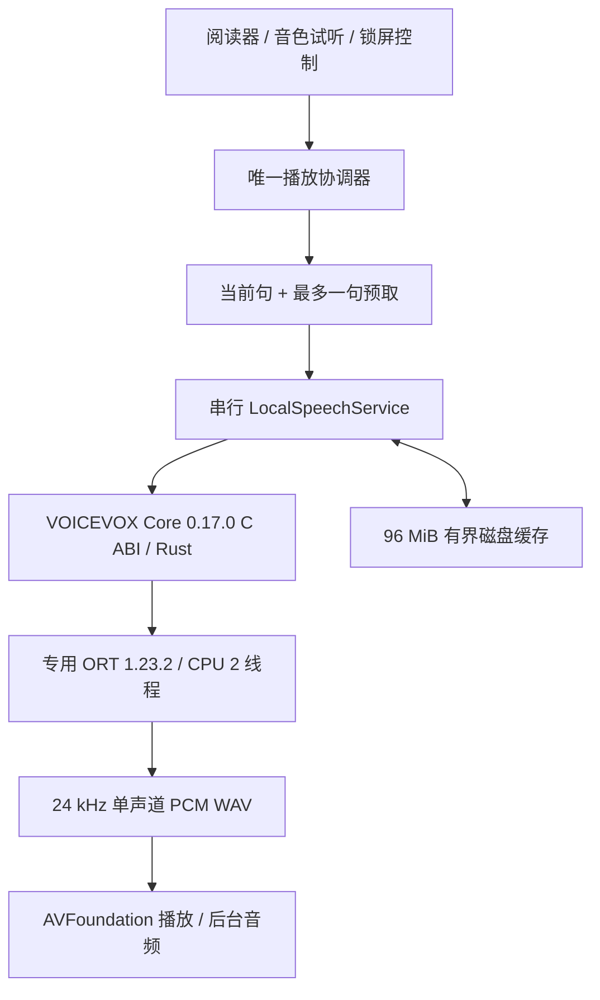

# 日语原生 TTS 集成与验证

2026-10-24 · AI Reader 0.1.0 · iOS 17+

已将 `vv_tts_server` 的四个现有音色接入 AI Reader。App 内直接调用 VOICEVOX C ABI，进入现有 Rust Core 和专用 ONNX Runtime，在后台队列完成推理；不启动 Python、HTTP、WebSocket 或本地网络服务。

此次实现了分析方案中具备现成模型和运行库支持的原生 CPU 路径。**Core ML / ANE 尚未接入**：当前 `vv_bin` 仍需要上游提供兼容后端，或提供获准转换的源模型。用 Swift、C 或 Rust 调用现有运行库不会自动启用 ANE。

## 实现结构



这是 App 进程内的服务，使用 iOS 支持的后台音频模式。有限时长的 background task 连接短暂的合成间隙；它不是独立守护进程，不能保证 App 被系统终止后继续合成。

### 四个音色

| style ID | 音色 | 风格 | 资源 |
|---|---|---|---|
| 0 | 四国めたん | あまあま | 0.vvm |
| 8 | 春日部つむぎ | ノーマル | 0.vvm |
| 14 | 冥鳴ひまり | ノーマル | 1.vvm |
| 24 | WhiteCUL | たのしい | 8.vvm |

所有音色都通过同一原生调用链运行。只保留一份 synthesizer 和一个活跃 VVM；跨 VVM 切换先卸载旧模型，0 / 8 共享模型。避免四套模型长期驻留 iPhone 内存。

### 已落地的优化与功能

- 日语按句、段落和停顿切分，默认每片不超过 60 字符；保留引号闭合字符和段落索引。按预测时长拒绝超过 30 秒的单次合成，限制瞬时内存和等待时间。
- 所有 C 指针只由串行队列操作。模型资源 SHA256 校验、推理、WAV 验证和缓存 I/O 均离开主线程。音频会话激活及播放器准备也使用独立队列。
- 当前句播放时只预取下一句；不把整篇文章一次性合成。2 个 CPU 线程是起始配置，仍需在目标 iPhone 测试后调整。
- 缓存标识覆盖文本、音色、语速、Core/ORT 版本和模型/词典资源清单。损坏 WAV 自动重建；按最后使用时间清理，预算 96 MiB。
- 会话 generation 与取消 ticket 丢弃旧输出；编辑、删除、换文档、换音色和换语速使旧任务失效。正在执行的同步 C 调用会运行完，再丢弃结果，不能硬中断。
- 播放、暂停、继续、停止、上一句/下一句、音色试听和持久化选择；实际应用 0.5–2× 语速。换速从当前句重新生成。
- 段落高亮/自动跟随、离开阅读器后的迷你播放器、后台音频和锁屏控制；中断、耳机拔出时暂停，媒体服务重置时停止。
- 语音缓存查看/清理、确认清空资料库时同步清除语音缓存、内存警告时释放推理资源、按段落保存位置避免逐句重写正文、离线署名和许可页面；旧偏好数据兼容解码。非日语资料继续支持文本阅读。

## 构建与资源复现

资源已经准备在工程中。重建资源时在项目根目录执行：

```sh
python3 Scripts/prepare_voicevox.py --source ../vv_tts_server
```

该脚本只用于开发准备，App 不包含 Python。它校验固定版本官方下载压缩包的 SHA256，再校验原有三个 VVM 的 SHA256；保留 VVM 权重，复制 OpenJTalk 词典、角色条款和开源许可，生成 `NativeAssets/Voicevox/manifest.json`。

固定运行库：VOICEVOX Core 0.17.0 / 专用 ORT 1.23.2。官方 ORT 框架的 Bundle ID 含下划线，脚本改为合法的连字符；官方模拟器框架还需要本地 ad-hoc 重签名，使 XCTest 从构建目录加载时签名有效。只调整打包元数据和签名，不修改推理代码或权重。真机内嵌框架由 Xcode 使用开发团队正常签名。

资源清单 identity：`4d557c01913a6fe717f9fb80ca1b0b00368297ef00e43c083a77dc8b91c5dc50`，共 25 个资源文件。模型、词典和许可约 270 MiB；Release iPhone App 未压缩构建约 293 MiB，不代表 App Store 下载大小。

```sh
swift test

xcodebuild -project AIReader.xcodeproj -scheme AIReader \
  -destination 'platform=iOS Simulator,name=iPhone 17e' \
  -derivedDataPath .build/NativeTTS -parallel-testing-enabled NO \
  -collect-test-diagnostics never -only-testing:AIReaderNativeTests test

xcodebuild -project AIReader.xcodeproj -scheme AIReader \
  -destination 'platform=iOS Simulator,name=iPhone 18 Pro' \
  -derivedDataPath .build/NativeTTS -parallel-testing-enabled NO \
  -collect-test-diagnostics never -only-testing:AIReaderUITests test

xcodebuild -project AIReader.xcodeproj -scheme AIReader \
  -configuration Release -destination 'generic/platform=iOS' \
  -derivedDataPath .build/DeviceRelease CODE_SIGNING_ALLOWED=NO build
```

模拟器名称按本机设备替换。`-collect-test-diagnostics never` 避免本机 Xcode 的 simctl diagnose 长时间阻塞结果写出，不会跳过测试。需要部署到 iPhone 时，在 Xcode 的 Signing & Capabilities 选择自己的开发团队，再正常运行。

## 实测与证据

验证环境为 Apple Silicon Mac 上的 iOS 27 模拟器，Xcode 27.1（27A9275），最低部署版本仍是 iOS 17。**以下数值不是 iPhone 真机性能，也没有用于推断 ANE 性能。**

同一文本：`こんにちは。今日は本を読みます。`，语速 1×，无现成 WAV 缓存，实际原生合成：

| style | 音频时长 | 请求耗时 | RTF |
|---|---:|---:|---:|
| 0 | 2.613 s | 1.445 s | 0.553 |
| 8 | 2.571 s | 0.938 s | 0.365 |
| 14 | 2.581 s | 1.376 s | 0.533 |
| 24 | 2.475 s | 1.277 s | 0.516 |

耗时包含资源准备和适用的模型切换，style 0 包含首次校验，style 8 复用 0.vvm；数据取自 20:32 的四音色测试，最终 9 项原生回归在 20:41 完成。每项为一次样本，不能用来比较音色计算效率或作为稳定延迟承诺。RTF = 请求耗时 / 输出时长，越小表示这次合成相对音频播放越快。未进行同设备、同条件的 Python / 原生对照基准，因此不宣称固定倍数的加速。

证据保存在 [verification/native-tts/](verification/native-tts/)：

- 核心测试：30 项通过，覆盖既有资料库功能、分句上限、旧偏好、缓存键/损坏/淘汰和取消。
- 原生测试：9 项通过，四个音色均非静音、24 kHz、输出 hash 各不相同；验证跨模型返回、实际语速变化、资源缺失/损坏、暂停期间迟到音频和正文 revision / 删除失效。
- UI 完整回归：12 项通过，0 失败、0 运行时警告；结果见该目录的 JSON 和日志，涵盖实际朗读、四音色试听、选择重启保留、暂停/跳句、进入后台再返回、编辑取消、资料库功能和缓存清理。
- 最新段落保存优化后，阅读专项 1 项通过；清空资料库同步清理语音缓存后，存储专项 1 项通过，均无运行时警告。
- Release / arm64 iPhone 架构构建成功（未签名）；Debug 模拟器真实合成与界面测试通过。
- [四音色数据](verification/native-tts/four-voices-cpu-measurements.json) 与 `style-0/8/14/24.wav` 为真实输出，保留对应 VOICEVOX 署名。

界面进入后台再返回的自动测试只验证会话保持及控件操作，不等同于长时间锁屏、音频连续性或系统回收验收。

## 仍需真机验证和后续优化

本机发现已配对 iPhone，但签名证书查询为 **0 个有效身份**，因此只完成 arm64 真机架构构建，未安装或声称通过真机验证。

1. 在目标 iPhone 飞行模式验证四音色及长文；记录冷启动到首个可听样本、热合成 P50/P95、逐句间隙、峰值 RSS、热降频、电量和耳机/电话/锁屏行为。模拟器结果不能替代这些数据。
2. 对 1 / 2 / 4 CPU 线程、不同分句长度和一句预取做同机比较，再决定机型默认值。当前 WAV 按句播放不是神经网络流式解码，仍可能有句间间隙；若真机存在间隙，评估 PCM 环形缓冲和 AVAudioEngine 连续调度。
3. 现阶段没有词级时间戳、任意音频拖动、定时停止、其他语言、OCR 或本地发音词典编辑。
4. ANE 路径继续以拿到获准转换的源模型或兼容 Core ML 的上游后端为前提，再推进分段导出、长度分桶、算子替换、数值/音质对齐、FP16/量化及真机计算单元验证。不能通过修改 vv_bin 后缀或开 `computeUnits` 获得 ANE。

## 代码入口

- `Sources/ReaderCore/{SpeechModels,SpeechWAV,LocalSpeechService}.swift`：分句、格式、串行服务与缓存。
- `AIReader/Speech/VoicevoxNativeRuntime.swift`：资源校验、C ABI、单模型生命周期。
- `AIReader/Speech/SpeechPlaybackCoordinator.swift`：会话、预取、播放器、后台和系统音频控制。
- `AIReader/App/AppStore.swift`、阅读器与设置页：资料一致性、实际控件和音色选择。
- `AIReaderNativeTests/`、`Tests/ReaderCoreTests/SpeechTests.swift`、`AIReaderUITests/`：真实合成、取消和界面验证。
